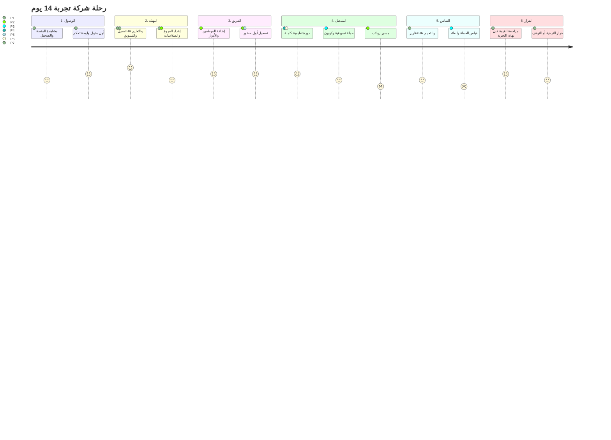

# خريطة تجربة العميل — شركة التجربة الشاملة (١٤ يوم)

> النسخة الأولى — مبنية على التينانت الحقيقي على `maxp.online`.
> الوحدات المفعّلة: **الموارد البشرية + النظام التعليمي + أدوات التسويق**.

| البند | القيمة |
|---|---|
| اسم الشركة | أكاديمية النخبة — شركة التجربة الشاملة |
| Tenant ID | `cmwp4ot8p0000juzaeqeysfg3` |
| Slug | `trial-academy-14d` |
| بداية التجربة | 2026-11-20 |
| نهاية التجربة | 2026-12-04 (١٤ يوم) |
| `trialModeEnabled` | `true` |
| التطبيقات المفعّلة | ٢٢ تطبيق (HR × 7، تعليم × 2، تسويق × 13) |
| بيانات وهمية | 7 موظفين، 50 سجل حضور، 5 رواتب، 4 أقسام، 5 طلاب، 16 حصة، 3 كورسات، 10 عملاء/ليدز، 3 كوبونات، حملتان FB، 4 مهام |

---

## ١. هدف الخريطة

الإجابة على سؤال واحد: **أين تنكسر تجربة صاحب شركة تعليمية وهو يشغّل HR + تعليم + تسويق لمدة أسبوعين على MaxP؟**

المخرجات:
1. رحلة موحّدة بـ ٦ مراحل + مسارات (Swimlanes) لكل شخصية.
2. Service Blueprint يوضح ما يحدث خلف الكواليس عند كل خطوة.
3. لحظات الحقيقة (Moments of Truth) ونقاط الاحتكاك المفترضة.
4. مدخلات مباشرة لاستخراج سيناريوهات الاختبار (الملف `02-test-scenarios.md`).

---

## ٢. الشخصيات (Personas)

| # | الشخصية | الهدف على المنصة | نقطة الدخول | بيانات التجربة الجاهزة | الدور |
|---|---|---|---|---|---|
| P1 | **مالك الشركة** (منى) | يشوف الصورة كاملة ويقرر التجديد | `/dashboard` | OWNER — ٢٤٣ صلاحية | `trial.owner@maxp.test` |
| P2 | **مدير الموارد البشرية** (خالد) | يشغّل الموظفين والحضور والرواتب | `/hr` | MANAGER + دور `TRIAL_HR_MANAGER` | `trial.hr@maxp.test` |
| P3 | **مدير التسويق** (هبة) | حملات + كوبونات + بث | `/advertising/facebook-ads/campaigns` | MANAGER + دور `TRIAL_MARKETING_MANAGER` | `trial.marketing@maxp.test` |
| P4 | **مدرس** (أ. محمود) | جدوله وحصصه | `/teacher` | EducationTeacher + Employee | `trial.teacher@maxp.test` |
| P5 | **موظف خدمة عملاء** (سارة) | يتابع الليدز والمهام | `/my-dashboard` | AGENT | `trial.agent@maxp.test` |
| P6 | **ولي أمر** (نهى إبراهيم) | يسجّل ابنه ويعرف مستواه | `/parent` / `/customer-portal` | Customer + ٢ أبناء + اشتراك | بيانات وهمية |
| P7 | **مدير المنصة** (دعم) | يفعّل/يوقف/يوسّع | `/super-admin` | SUPER_ADMIN | حساب المنصة |

**كلمة السر الموحّدة لكل الحسابات:** `Maxp@2026`

---

## ٣. خريطة الرحلة (Journey Map)

**قراءة المنحنى:** أعلى رضا في التفعيل، وأدنى رضا في **مسير الرواتب** و**قياس العائد التسويقي** — وهما أول مكانين للاختبار المكثّف.

---

## ٤. المراحل التفصيلية

### المرحلة ١ — الوصول والدخول (Day 0)

| العنصر | التفاصيل |
|---|---|
| هدف العميل | «أفهم المنصة وأدخل بسرعة» |
| نقاط التلامس | صفحة الدخول `/login` → إعادة التوجيه للوحة التحكم |
| تصرفات | إدخال البريد/كلمة السر → اختيار الشركة إن تعددت → استكشاف القائمة |
| المشاعر | حماس + حذر (هل دي فعلاً منصة واحدة لكل حاجة؟) |
| نقاط الألم المتوقعة | لغة/اتجاه RTL، تحميل القائمة الكبيرة، ظهور وحدات غير مفعّلة |
| الفرص | Onboarding checklist داخل اللوحة، جولة تعريفية، حالة الوحدات في الأعلى |
| القياس | زمن أول دخول ناجح < ١٠ ثوانٍ، صفر أخطاء Console |

### المرحلة ٢ — التهيئة وتفعيل الوحدات (Day 0–1)

| العنصر | التفاصيل |
|---|---|
| هدف العميل | «الوحدات الثلاثة شغالة فعلاً مش مجرد أيقونات» |
| نقاط التلامس | `/settings`، `/my-apps`، السايدبار، مركز التفعيل |
| تصرفات | التحقق من ظهور HR/التعليم/التسويق → ضبط العملة والتوقيت → إعداد المؤسسة التعليمية |
| المشاعر | قلق من التعقيد |
| نقاط الألم | تطبيق مفعّل لكن القسم مخفي (تعارض `activeApps` مع صلاحيات الدور)؛ اعتماد تطبيق على آخر (`coupons-pro` يحتاج `store`) |
| الفرص | مؤشر «٣/٣ وحدات جاهزة»، تحذير واضح للاعتماديات |
| القياس | Activation = ٣ وحدات ظاهرة + قابلة للاستخدام بدون 403 |

### المرحلة ٣ — بناء الفريق والأدوار (Day 1–2)

| العنصر | التفاصيل |
|---|---|
| هدف العميل | «كل واحد يشوف شغله بس» |
| نقاط التلامس | `/users-management`، `/roles`، `/hr/employees`، `/hr/departments` |
| تصرفات | إضافة موظف → ربطه بقسم ووظيفة → إسناد دور → تسجيل دخول الموظف |
| المشاعر | إحساس بالسيطرة عند نجاح الفصل بين الأدوار |
| نقاط الألم | دور MANAGER بدون صلاحيات = قائمة فاضية (fail-safe)؛ موظف مربوط بـ User لكن غير مربوط بـ Employee |
| الفرص | قوالب أدوار جاهزة (HR / تسويق / مدرس) |
| القياس | ٥ أدوار تعمل بدون تدخّل دعم |

### المرحلة ٤ — التشغيل اليومي (Day 2–11) — ٣ مسارات متوازية

#### ٤-أ. مسار الموارد البشرية
| العنصر | التفاصيل |
|---|---|
| نقاط التلامس | `/hr/attendance`، `/hr/leaves`، `/hr/payroll`، `/my-attendance`، `/my-payslip` |
| تصرفات | حضور يومي → طلب إجازة → اعتماد → احتساب راتب → كشف للموظف |
| نقاط الألم | احتساب التأخير/الغياب، ازدواج مسير نفس الشهر، تسلسل الاعتماد |
| القياس | مسير شهر كامل بدون خطأ احتساب |

#### ٤-ب. مسار المركز التعليمي
| العنصر | التفاصيل |
|---|---|
| نقاط التلامس | `/admin/education/{dashboard,students,teachers,groups,sessions,enrollments,demo-day}` + بوابة ولي الأمر |
| تصرفات | تسجيل طالب → باقة → تعيين مدرس → جدولة حصة → خصم ساعات → شهادة/تقرير مستوى |
| نقاط الألم | ربط الطالب بولي أمر موجود، خصم الساعات، تعارض مواعيد المدرس |
| القياس | دورة كاملة (تسجيل → حصة → خصم → تقرير) بدون خطوة يدوية خارج المنصة |

#### ٤-ج. مسار التسويق
| العنصر | التفاصيل |
|---|---|
| نقاط التلامس | `/advertising/facebook-ads/*`، `/coupons`، `/whatsapp/template-broadcast`، `/competitors` |
| تصرفات | بناء حملة → جمهور → كرييتيف → كوبون → بث → قياس |
| نقاط الألم | ربط صفحة فيسبوك/حساب إعلاني، صلاحية التوكن، نسبة الإسناد (Attribution) |
| القياس | حملة تُنشأ وتُقاس، كوبون يُستخدم ويظهر في التقرير |

### المرحلة ٥ — القياس والتحسين (Day 11–13)

| العنصر | التفاصيل |
|---|---|
| هدف العميل | «أثبت إن المنصة بتوفر فلوس/وقت» |
| نقاط التلامس | لوحة التحكم، `/hr/reports-hub`، `/admin/education/reports`، تقارير الحملات |
| المشاعر | إما ثقة أو إحباط لو الأرقام مش متطابقة |
| نقاط الألم | تضارب الأرقام بين الشاشة والتقرير، فترات زمنية مختلفة |
| القياس | تطابق رقم واحد (مثال: عدد الحصص) في ٣ شاشات |

### المرحلة ٦ — قرار التجديد (Day 14)

| العنصر | التفاصيل |
|---|---|
| هدف العميل | «أدفع ولا أوقف؟» |
| نقاط التلامس | بانر التجربة، `PlatformSubscription`، `/subscription`، إشعارات |
| تصرفات | مقارنة القيمة → ترقية → أو تمديد/توقف |
| نقاط الألم | انتهاء التجربة يقفل التطبيقات فجأة، رسالة غير واضحة |
| الفرص | تقرير «قيمة الـ١٤ يوم» + خطة سعرية واضحة |
| القياس | Conversion rate Trial → Paid، أسباب التوقف |

---

## ٥. مخطط الخدمة (Service Blueprint)

| المرحلة | Front Stage (يشوفه العميل) | Backstage (ما لا يراه) | الأنظمة/البيانات | مؤشر الجودة |
|---|---|---|---|---|
| ١ الوصول | شاشة دخول عربية | `authenticateToken`, تحميل `installedApps`, `permissions` | `users`, `user_companies`, `roles`, `company_apps` | زمن استجابة < ١٫٥ ث |
| ٢ التهيئة | أيقونات الوحدات + إعدادات | `checkAppAccess → filterActiveCompanyAppSlugs` | `company_apps`, `marketplace_apps`, `companies.settings` | ٠ خطأ 403 على الشاشات المفعّلة |
| ٣ الفريق | إضافة موظف/دور | `permissionService.getUserPermissions`, `roleRef` | `hr_employees`, `hr_departments`, `hr_positions`, `roles`, `role_permissions` | كل دور يرى ما يخصه فقط |
| ٤-أ HR | حضور، إجازات، رواتب | احتساب التأخير، تجميع المسير | `hr_attendances`, `hr_leave_requests`, `hr_payrolls` | صفر ازدواج في `(userId,month,year)` |
| ٤-ب تعليم | طلاب، مجموعات، حصص | خصم الساعات، ربط الطالب بولي الأمر | `education_*` | رصيد الساعات = المتبقي فعلياً |
| ٤-ج تسويق | حملات، كوبونات، بث | مزامنة Meta، حساب الجمهور | `facebook_*`, `coupons`, `broadcast_campaigns` | صفر حملة «مفعلة» بدون صفحة مربوطة |
| ٥ القياس | تقارير | تجميع يومي/لحظي | `daily_analytics`, تقارير لكل وحدة | نفس الرقم في ٣ شاشات |
| ٦ القرار | بانر التجربة والترقية | `PlatformSubscription`, `trialEndsAt` | `companies.trialEndsAt`, `platform_subscriptions` | رسالة واضحة قبل ٧٢ ساعة |

---

## ٦. لحظات الحقيقة (Moments of Truth)

| ID | اللحظة | لماذا حاسمة | المرحلة |
|---|---|---|---|
| MoT-1 | أول دخول ناجح ولوحة تحكم عربية بدون أخطاء | تكوّن الانطباع الأول في ٧ ثوانٍ | ١ |
| MoT-2 | رؤية الوحدات الثلاثة مفعّلة فعلياً | تثبت الوعد الأساسي «منصة واحدة» | ٢ |
| MoT-3 | أول موظف يظهر في الحضور ويقدر يسجّل دخول | تثبت أن الأدوار تعمل | ٣ |
| MoT-4 | أول مسير رواتب صحيح | أعلى نقطة احتكاك متوقعة | ٤-أ |
| MoT-5 | أول طالب يكمل حصة وتُخصم ساعته | جوهر قيمة التعليم | ٤-ب |
| MoT-6 | أول حملة/كوبون يعطي رقماً قابلاً للقياس | يبرر سعر التسويق | ٤-ج |
| MoT-7 | تقرير المالك الموحّد | لحظة «المنصة بتفكر معايا» | ٥ |
| MoT-8 | إشعار نهاية التجربة + خيار الترقية | لحظة القرار المالي | ٦ |

---

## ٧. نقاط الاحتكاك المفترضة (Friction Hypotheses)

| ID | الفرضية | الشدة | الوحدة | سيناريو الإثبات |
|---|---|---|---|---|
| F-01 | تطبيق مفعّل لكن القسم مخفي بسبب صلاحيات الدور | عالية | عام | TS-AUTH-04 |
| F-02 | MANAGER بلا صلاحيات يرى قائمة فاضية بدون رسالة | متوسطة | عام | TS-AUTH-05 |
| F-03 | ازدواج مسير الرواتب لنفس الشهر | عالية | HR | TS-HR-11 |
| F-04 | احتساب التأخير خطأ عند وجود إجازة في نفس اليوم | عالية | HR | TS-HR-07 |
| F-05 | طالب بدون ولي أمر مسجّل لا يمكن إنشاؤه | متوسطة | تعليم | TS-EDU-03 |
| F-06 | خصم ساعات الحصة مرتين عند تأكيد مكرر | عالية | تعليم | TS-EDU-09 |
| F-07 | تعارض مواعيد المدرس بين مجموعة وحصة خاصة | متوسطة | تعليم | TS-EDU-11 |
| F-08 | حملة «مفعلة» بدون حساب إعلاني/صفحة مربوطة | عالية | تسويق | TS-MKT-05 |
| F-09 | كوبون مكرر أو يتجاوز حد الاستخدام | متوسطة | تسويق | TS-MKT-03 |
| F-10 | أرقام التقرير لا تطابق الشاشة | عالية | قياس | TS-X-03 |
| F-11 | انتهاء التجربة يقفل الوحدات بدون تحذير مسبق | عالية | قرار | TS-RET-01 |
| F-12 | تسريب بيانات بين tenants عبر API بدون `companyId` | حرجة | أمان | TS-SEC-01 |
| F-13 | عرض شاشات HR على الموبايل (390px) مكسور | متوسطة | موبايل | TS-NFR-02 |
| F-14 | وصول دور التسويق لبيانات HR عبر API مباشر | عالية | أمان/أدوار | TS-SEC-03 |

> **F-14 مؤكدة مبدئياً في تشغيل التينانت:** استدعاء `GET /api/v1/hr/employees` بحساب مدير التسويق رجع `200` — الحماية على مسار HR هي `checkAppAccess('hr-core')` فقط بدون فحص صلاحية `hr.employees`. تم تسجيلها كسيناريو اختبار إجباري.

---

## ٨. مؤشرات التجربة (KPIs)

| المؤشر | التعريف | الهدف في ١٤ يوم |
|---|---|---|
| TTFV | الزمن من أول دخول لأول قيمة (أول موظف + أول طالب + أول كوبون) | < ٤٨ ساعة |
| Module Activation | نسبة الوحدات الثلاثة المستخدمة فعلياً (فيها بيانات) | ٣/٣ |
| Role Coverage | عدد الأدوار التي دخلت ونفّذت إجراءً واحد على الأقل | ٥/٥ |
| Task Success Rate | نسبة السيناريوهات الناجحة من أول محاولة | ≥ ٨٥٪ |
| Error Rate | أخطاء 4xx/5xx غير متوقعة لكل جلسة | < ٢٪ |
| Data Integrity | تطابق رقم مرجعي واحد في ٣ شاشات | ١٠٠٪ |
| Trial → Paid | قرار الترقية قبل اليوم ١٤ | ≥ ٣٠٪ |

---

## ٩. مصفوفة التتبع: لحظة الحقيقة → السيناريوهات

| MoT | السيناريوهات المرتبطة |
|---|---|
| MoT-1 | TS-AUTH-01…03، TS-NFR-01 |
| MoT-2 | TS-ENV-01…05، TS-ENV-09 |
| MoT-3 | TS-AUTH-04…06، TS-HR-01…03 |
| MoT-4 | TS-HR-08…12 |
| MoT-5 | TS-EDU-01…11 |
| MoT-6 | TS-MKT-01…10 |
| MoT-7 | TS-X-01…05 |
| MoT-8 | TS-RET-01…04 |

السيناريوهات نفسها في `docs/qa/trial-14d/02-test-scenarios.md`.
