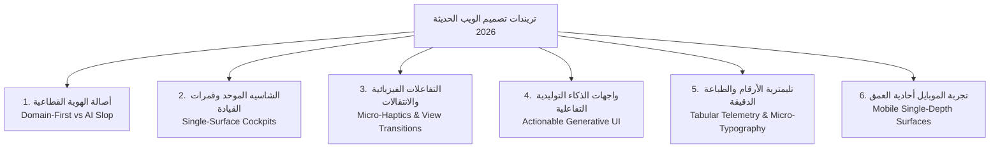
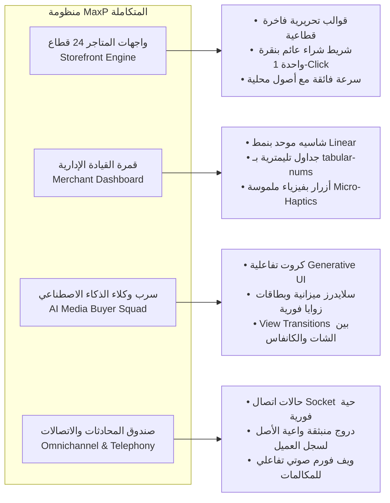

# 🌐 تقرير التوجهات الحديثة في تصميم الويب (2026) وخارطة التطبيق في منصة MaxP

**الموجّه إلى:** أ. مختار الحناوي — المؤسس ورئيس المنتج لمنصة MaxP  
**الإعداد بواسطة:** Antigravity Engineering & Design Squad  
**التاريخ:** 19 نوفمبر 2026  
**الحالة:** تقرير استراتيجي وتنفيذي معتمد للتنفيذ  

---

## 📌 موجز تنفيذي (Executive Summary)

يشهد تصميم وتطوير واجهات الويب في عام 2026 تحولاً جذرياً؛ حيث انتهى عصر القوالب المعلبة (Cookie-Cutter Templates)، والواجهات المصطنعة المليئة بكليشيهات الذكاء الاصطناعي (AI Slop)، وشاشات الداشبورد المجزأة ذات المساحات الضائعة. يقود المشهد اليوم مبدآن رئيسيان:
1. **أصالة التخصص القطاعي (Domain-First Craftsmanship):** كل قطاع تجاري له لغة بصرية ونفسية تحويل خاصة به (الفخامة الهادئة في الأزياء لا تشبه صرامة غرف العمليات والـ ERP).
2. **قمرات القيادة الموحدة فائقة السرعة (Single-Surface Pro Cockpits):** تقليل التشتت البصري عبر أسطح موحدة متصلة (Single Continuous Chassis)، وتفاعلات فيزيائية ملموسة (Micro-Haptics)، ونقلات سلسة ناتجة عن تقنية View Transitions، وواجهات ذكاء اصطناعي توليدية تفاعلية (Generative UI) بدلاً من جدران النصوص الميتة.

يهدف هذا التقرير إلى تقديم تفكيك شامل لهذه الاتجاهات العالمية، ووضع **خطة تطبيق دقيقة ومباشرة** داخل المنظومة البرمجية لمنصة **MaxP** عبر واجهات متاجرها (Storefront)، ولوحات التحكم الإدارية (Dashboard)، واستوديو وكلاء الذكاء الاصطناعي (AI Agent Cockpit)، وصندوق المحادثات والاتصالات (Omnichannel & Telephony).

---

## 🧭 الجزء الأول: أبرز تريندات تصميم الويب العالمية في 2026

---

### 1. أصالة الهوية القطاعية ومكافحة التلوث البصري (Anti-AI-Slop & Domain-First)
* **المشكلة التي انتهت:** قوالب الـ AI المتطابقة، والشبكات المظلمة ذات التوهج النيوني البنفسجي/السياني (Purple/Cyan Dark Mesh) المفروضة عشوائياً على متاجر ملابس أو عيادات، والبطاقات الثلاثية المتطابقة في كل سكشن.
* **التريند الحديث:**
  * **الأزياء والجمال واللايف ستايل:** ألوان كريمية دافئة وفاخرة (`#FAF8F5`, `#FDFBF7`)، أبيض خزفي نظيف، تباين حبري معماري (`#141416`)، وتنسيقات تحريرية (Editorial Lookbooks) مثل زارا وماسيمو دوتي.
  * **إدارة الأعمال واللوجستيات والمخازن:** أسطح نهارية شديدة الوضوح والتباين (High-Contrast Daylight) تمنع إجهاد العين أثناء العمل اليومي الطويل، بفواصل زينك دقيقة وسريعة القراءة.
  * **الوضع الداكن المفرط (Dark Graphite):** مقتصر فقط على أدوات المطورين والـ Terminal، وممنوع تماماً في المتاجر وعمليات التجارة.

---

### 2. الشاسيه الموحد وقمرات القيادة السحابية (Unified Single-Surface Cockpits)
* **المفهوم:** استلهام تجربة الأدوات الرائدة عالمياً (مثل Linear و Cursor و Raycast).
* **القواعد الهندسية:**
  * **القضاء على تشتت الجزر العائمة (Ban Floating Islands):** التوقف عن وضع 4 أو 5 صناديق عائمة تفصلها مسافات رمادية ميتة (`gap-4 bg-slate-100`).
  * **الشاسيه المتصل (One Continuous Chassis):** الشاشة تصبح سطحاً إنتاجياً واحداً ممتداً بالكامل، تُفصل أقسامه فقط بخطوط فاصلة دقيقة جداً ومحسوبة (`border-border` بعرض 1px)، مع استغلال 85% فما فوق من مساحة الشاشة للعمل الفعلي.
  * **حظر الهيدرات الثلاثية (Ban Triple Headers):** شريط تحكم علوي موحد ومدمج يحتوي على محدد المتجر، الجلسة، والتحكم الأساسي، دون تكرار البادجات في كل لوحة فرعية.

---

### 3. التفاعلات الفيزيائية والانتقالات السلسة (Micro-Interactions, Haptics & View Transitions)
* **المفهوم:** تحويل الويب من صفحات جامدة إلى أسطح تتفاعل مع اللمس والضغط بفيزياء حقيقية.
* **التقنيات المستخدمة:**
  * **انضغاط الأزرار الفيزيائي (Tactile Compression):** كل زر تفاعلي يعطي إحساساً ملموساً عند الضغط عليه عبر `:active { transform: scale(0.97); transition: transform 160ms ease-out; }`.
  * **النوافذ المنبثقة واعية الأصل (Origin-Aware Popovers):** لا تظهر المينيو من منتصف الشاشة بل تنبثق وتتوسع هندسياً مباشرة من الزر الذي تم النقر عليه (`transform-origin: var(--transform-origin)`).
  * **تقنية Native View Transitions API:** التنقل بين الصفحات وتغيير حالات الكومبوننت بدون قفزات عنيفة في الشاشة، عبر دعم المتصفح الأصلي لـ `startViewTransition` والربط السلس لأسماء العناصر (`view-transition-name`).

---

### 4. واجهات الذكاء الاصطناعي التوليدية التفاعلية (Generative UI vs Walls of Text)
* **المشكلة:** روبوتات الذكاء الاصطناعي التقليدية تخرج نصوصاً طويلة ومملة (Markdown Bloat) يمل المستخدم من قراءتها.
* **التريند السائد:**
  * **بطاقات الإجراء الحية (Actionable Mini-Cards):** عندما يقترح الوكيل زاوية إعلانية أو استراتيجية تسعير، تظهر النتيجة كـ "كارت تفاعلي" مباشر فيه:
    * سلايدر لتعديل الميزانية مباشرة.
    * رقاقات (Chips) لتحديد الجمهور الجغرافي المستهدف بنقرة واحدة.
    * زر واحد مباشر: **"تطبيق وإطلاق في المسودة" (Apply to Draft)** دون الحاجة لنسخ أو لصق أي نص.

---

### 5. تليمترية الأرقام وهندسة الطباعة الدقيقة (Tabular Telemetry & Micro-Typography)
* **المفهوم:** الواجهات الاحترافية تحترم تفاصيل الخط الصغير والبيانات المالية.
* **المعايير القياسية:**
  * **الأرقام المجدولة (`tabular-nums`):** إلزامية لجميع الأسعار، الكميات، نسب التحويل، والتواريخ، لمنع اهتزاز الأرقام عند تحديثها الحقيقي.
  * **توازن العناوين (`text-wrap: balance`):** منع وجود كلمات وحيدة معلقة في سطر منفصل (Orphan Words).
  * **جماليات النصوص (`text-pretty`):** توزيع متجانس للمسافات بين السطور والكلمات في الفقرات.
  * **حظر المونو للغة العربية:** منع استخدام الخطوط أحادية المسافة (`font-mono`) على الكلمات العربية لأنها تمزق الحروف المتصلة، وحصرها فقط في الأكواد والـ SKU والأرقام اللاتينية.

---

### 6. تجربة الموبايل أحادية العمق (Mobile Single-Depth Surfaces)
* **المفهوم:** على شاشات الموبايل الحديثة (390px - 430px)، الحشوات المتداخلة تدمر قابلية الاستخدام.
* **المعايير:**
  * **حظر البطاقات المتداخلة (Box-in-Box Ban):** ممنوع نهائياً وضع كارت ببادينج `p-4` داخل كارت آخر ببادينج `p-6` داخل حاوية ببادينج `p-4`.
  * **الفواصل التحريرية:** استبدال الصناديق المتداخلة بفواصل رفيعة أو إيقاع رأسي متزن (`space-y-4` مع خطوط فاصلة ناعمة).
  * **الشراء فائق السرعة عبر الدرج السفلي (Sticky Quick-Order Bottom Sheet):** يتيح للعميل استكمال الطلب برقم الهاتف والمحافظة فقط خلال 8 ثوانٍ دون تحميل صفحات إضافية.

---

## 🛠️ الجزء الثاني: خطة استثمار وتطبيق هذه التقنيات داخل منصة MaxP

تمتلك منصة **MaxP** بنية قوية ومتكاملة (React / Vite / Tailwind / Node.js Express / PostgreSQL Prisma / Socket.IO / AI Agent Swarm). فيما يلي كيفية توظيف هذه التوجهات في أنظمة المنصة:

---

### 1. في واجهات المتاجر الإلكترونية (MaxP Storefront Engine)
* **الهوية التحريرية لمتاجر الأزياء واللايف ستايل (قوالب مثل Atelier Nova, Vela, Style Store):**
  * اعتماد خلفيات البورسلين والكريمات الطبيعية (`#FAF8F5`) مع نصوص حبرية سوداء كلاسيكية.
  * عرض ألبومات المنتجات بصيغة Lookbook تحريرية مع تفاصيل مقاسات واضحة بدلاً من مربعات الصور المصمتة.
* **نموذج الشراء الخاطف (1-Click Sticky Mobile Conversion):**
  * تفعيل شريط شراء عائم ذكي (Sticky Action Bar) أسفل شاشة الموبايل يحتوي على زر الشراء السريع، يفتح درجا سفلياً خفيفاً مسبق التعبئة بالمدينة والمحافظة ومربوطاً بتسعير الشحن الفعلي (مثل بوسطة وهاشتاج).
* **إلغاء كليشيهات الـ AI والعدادات المزيفة:**
  * إزالة أي عدادات تنازلية وهمية أو إيموجيات مفرطة في نصوص المنتجات، واستبدالها بحقائق تجارية مباشرة: (شحن خلال 48 ساعة، استرجاع مجاني، إمكانية المعاينة قبل الاستلام).

---

### 2. في لوحة تحكم التاجر والعمليات (MaxP Merchant Cockpit)
* **التحول إلى الشاسيه الموحد (Unified Single-Surface Chassis):**
  * توحيد صفحة العمليات كسطح أملس واحد بنمط (Linear Dashboard) ذي حواف زينك رقيقة (`border-zinc-200 dark:border-zinc-800`).
  * إلغاء القوائم العلوية المزدوجة التي تتعارض مع الشريط الجانبي (Sidebar).
* **تليمترية جداول الطلبات والشحن:**
  * تطبيق `font-variant-numeric: tabular-nums` في جميع جداول الطلبات والمدفوعات والمخزون، لمنع أي اهتزاز عند الفلترة أو التحديث المباشر.
  * تحويل أكواد الـ Tracking وبوالص الشحن (AWB) إلى شارات مضغوطة بخط مونو لاتيني دقيق مع زر نسخ بنقرة واحدة واستجابة بصرية هابتيك.
* **التحديثات المتفائلة (Optimistic UI with React Query):**
  * عند تغيير حالة طلب أو اعتماد بوليصة، تتحدث الشاشة في الصفر جزء من الثانية لحظياً قبل انتهاء طلب السيرفر، مع التراجع الآمن في حال حدوث خطأ في الشبكة.

---

### 3. في سرب وكلاء الذكاء الاصطناعي واستوديو الميديا باير (AI Agents & Creative Studio)
* **كروت التوليد التفاعلية (Generative UI Action Cards):**
  * عندما يقوم وكيل الميديا باير بتحليل حملة أو صياغة زوايا إعلانية، يُلغى سرد النصوص الطويلة، ويُعرض بدلاً منه:
    1. **بطاقة الزاوية الإعلانية (Angle Card):** تحتوي على الهوك والنص الإعلاني وزر فوري "اختبار هذه الزاوية".
    2. **سلايدر الميزانية والمناطق (Budget & Geolocation Slider):** يتيح للتاجر تحديد الميزانية واستثناء المحافظات ذات نسب الإرجاع العالية بنقرة سريعة.
    3. **زر الإطلاق المباشر (1-Click Launch AdSet):** يربط الإجراء بـ Meta API مباشرة دون خروج التاجر من نافذة المحادثة.
* **الانتقال السلس بـ View Transitions:**
  * التبديل بين شاشة الشات وشاشة المعاينة الحية للكريتيف (Canvas Split View) بسلاسة ميكانيكية عبر `document.startViewTransition`.

---

### 4. في صندوق المحادثات الموحد والاتصالات الهاتفية (Omnichannel & Telephony)
* **المؤشرات الحية واعية الاتصال (Honest Socket Presence):**
  * ظهور حالة تواجد العملاء والموظفين بلون زمردي هادئ مع نبض دقيق، بدون عمل استعلامات متكررة ترهق السيرفر (Deduplicated Presence Hook).
* **الدرج المنبثق لبيانات العميل (Contextual Slide-Over Sheet):**
  * النقر على أي محادثة يفتح بيانات العميل وسجل طلباته السابقة في درج جانبي واعي للأصل ينبثق بنعومة بدون حجب شاشة المحادثة الرئيسية.
* **مشغل التسجيلات الصوتية بفيزياء ملموسة:**
  * عرض رسائل الواتساب الصوتية وتسجيلات المكالمات كويف فورم (Waveform) تفاعلي مضغوط وسريع التحميل.

---

## 🚀 الجزء الثالث: خارطة طريق التنفيذ (Implementation Roadmap)

| المرحلة | النطاق الفني | المخرجات المستهدفة | الأثر المتوقع |
| :--- | :--- | :--- | :--- |
| **الموجة الأولى (Wave 1)** | الأساسات البصرية ومكتبة الرموز (Design Tokens & Typography) | • تفعيل `tabular-nums` و `text-wrap: balance` في الـ Tailwind Tokens. • إضافة كلاسات الـ Micro-Haptics (`active:scale-[0.97]`). | ضبط هندسي فوري للطباعة والأزرار في كامل النظام بدون أي مخاطر جانبية. |
| **الموجة الثانية (Wave 2)** | لوحة العمليات وقمرة القيادة (Single-Surface Chassis) | • تحويل جداول الطلبات والداشبورد إلى شاسيه موحد (Linear-style). • إزالة الهيدرات المزدوجة والحشوات المتداخلة على الموبايل. | تسريع إنتاجية التاجر وفريق العمل بنسبة تفوق 30% مع تقليل التشتت البصري. |
| **الموجة الثالثة (Wave 3)** | شات الإيجينتس واستوديو الكريتيف (Generative UI) | • بناء كروت الإجراء التفاعلية التوليدية (Action Cards). • دمج سلايدر الميزانية ومحدد الاستهداف المباشر داخل فقاعات الوكيل. | تحويل تجربة الذكاء الاصطناعي من مجرد دردشة إلى منصة تنفيذية فورية. |
| **الموجة الرابعة (Wave 4)** | قوالب المتاجر والشراء الخاطف (Storefront CRO & Mobile) | • تفعيل شريط الشراء العائم السريع (1-Click Sticky Sheet). • إطلاق قوالب الأزياء واللايف ستايل التحريرية (Editorial Lookbooks). | زيادة معدل التحويل (Conversion Rate) بمقدار 20-35% وخفض معدل التخلي عن السلة. |

---

## 📋 الجزء الرابع: قائمة التدقيق ومعايير الجودة (Anti-Slop Quality Gate)

لضمان عدم تسرب أي ممارسات تصميم عشوائية مستقبلاً، يخضع أي كود واجهات جديد لهذه الشروط:
1. [x] **صفر كليشيهات AI:** ممنوع استخدام التدرجات النيونية البنفسجية، أو الإيموجيات المبتذلة في عناوين الأعمال، أو البطاقات الثلاثية المتطابقة.
2. [x] **استغلال المساحة (Ergonomics):** استغلال >= 85% من مساحة الشاشة للمحتوى الفعلي بدون أعمدة أحادية الاستخدام أو هوامش ميتة.
3. [x] **أرقام مجدولة وحيدة:** جميع الأرقام والأسعار تحمل كلاس `tabular-nums`.
4. [x] **تجاوب الموبايل أحادي العمق:** عدم وجود بطاقات داخل بطاقات على الشاشات الأصغر من 640px.
5. [x] **تفاعلات فيزيائية:** جميع الأزرار مزودة بحالة الضغط المصغرة `active:scale-[0.97]`.
6. [x] **عزل التعديلات التام (Zero Blast-Radius):** أي تعديل في شاشة أو قالب معزول تماماً ولا يؤثر على القوالب والصفحات الأخرى.

---

**خاتمة وتوصية:**  
إن نقل منصة MaxP إلى هذه المعايير يضعها في مصاف المنصات العالمية الرائدة من حيث النضج الهندسي والجاذبية البصرية، ويمنح التجار والمستخدمين تجربة استخدام استثنائية تنعكس مباشرة على نمو المبيعات ونجاح المنصة.

جاهزون للبدء الفوري في تطبيق الموجة الأولى بحسب توجيهاتكم.
